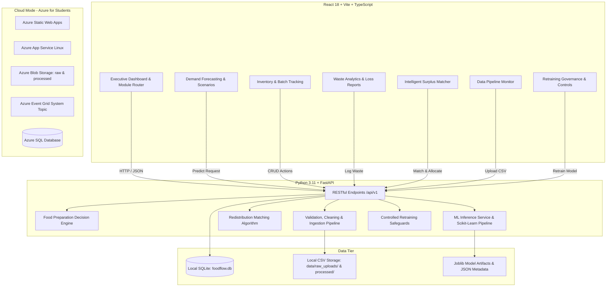
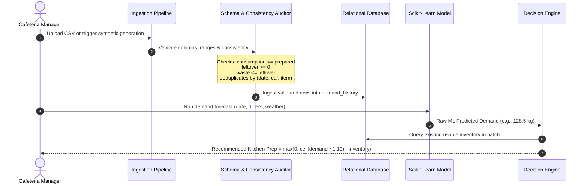
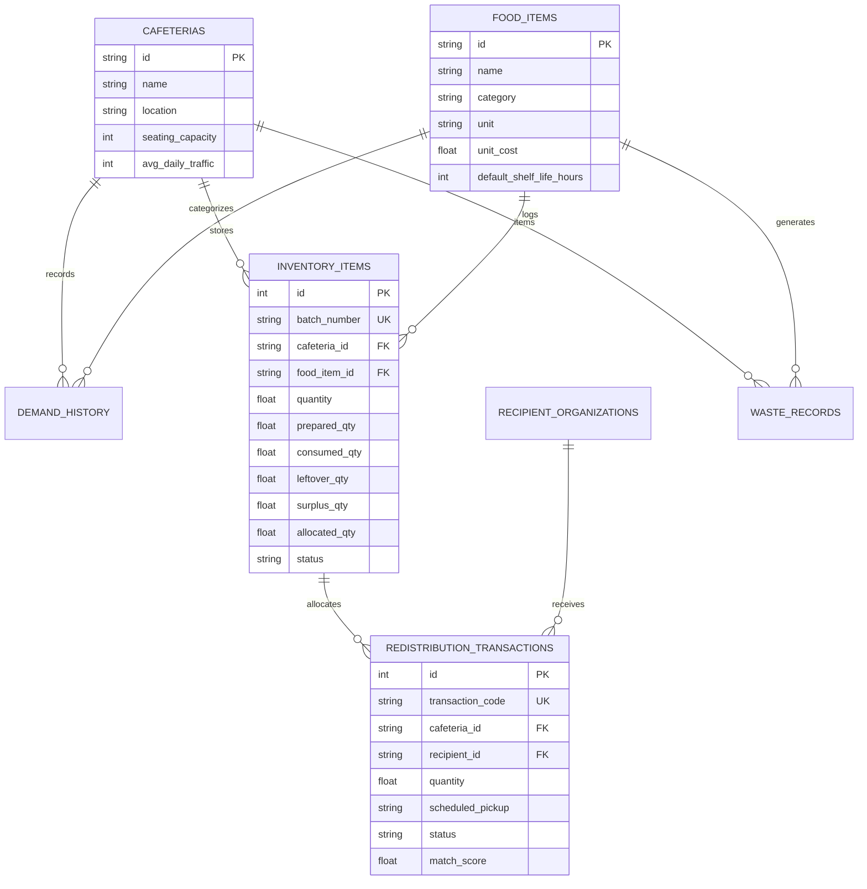

# FoodFlow: AI-Based Food Demand Prediction, Waste Prevention & Intelligent Redistribution Platform

[](https://github.com/mugilan/foodflow/actions)
[](https://opensource.org/licenses/MIT)
[](https://www.python.org/)
[](https://fastapi.tiangolo.com/)
[](https://react.dev/)
[](https://tailwindcss.com/)
[](https://scikit-learn.org/)
[](https://azure.microsoft.com/free/students/)

> **FoodFlow** is an enterprise-grade full-stack platform built for college cafeterias, institutional dining halls, and community food banks. It combines machine learning demand forecasting, rule-based preparation optimization, food inventory tracking, waste loss analytics, and automated surplus redistribution.

---

## 1. Project Overview & Problem Statement

College cafeterias and institutional food providers face severe volatility in daily diner footfall due to changing class schedules, weather conditions, academic holidays, and special campus events. Consequently:
- **Over-preparation** causes tens of thousands of kilograms of edible food to be dumped in landfills, generating methane emissions and wasting institutional budgets.
- **Under-preparation** causes food shortages, student dissatisfaction, and kitchen panic.
- **Redistribution friction**: Kitchens lack real-time digital matchmaking with local homeless shelters, student food pantries, and food banks, leading to edible leftovers spoiling before collection.

### Core Objectives
1. **Predict Food Demand**: Machine learning forecasting model predicting item demand per cafeteria meal period.
2. **Optimize Preparation**: Rule-based decision engine calculating net prep needed: `max(0, ceil(forecast * (1 + buffer)) - inventory)`.
3. **Audit Waste & Financial Loss**: Track root causes (over-preparation, shelf-life expiration, handling damage) and financial costs.
4. **Intelligently Match Surplus**: Transactionally match surplus batches with verified community recipients based on food compatibility, distance, storage capacity, and safe shelf life.
5. **Zero External Dependencies**: Operates autonomously with reproducible synthetic datasets (5,000+ records) and is cloud-ready for **Microsoft Azure for Students**.

---

## 2. Platform Architecture



---

## 3. Data Pipeline & Machine Learning Workflow



---

## 4. Machine Learning Model & Evaluation Results

The machine learning pipeline is built with **Scikit-learn** and avoids all temporal data leakage using strict **chronological train/test splits**.

### Features Used:
- **Numerical Features**: `expected_customer_count`, `recent_avg_demand` (7-day historical lag), `historical_food_demand` (30-day lag), `temperature_c`, `is_weekend`, `is_holiday`, `is_special_event`.
- **Categorical Features**: `cafeteria_id`, `food_item_id`, `food_category`, `day_of_week`, `weather_condition`.
- **Target**: `actual_demand` (numeric quantity consumed + unmet demand).

### Model Evaluation on Held-Out Test Data (980 Future Observations):
| Model | Algorithm | Test MAE | Test RMSE | Held-Out R² | Status |
| :--- | :--- | :--- | :--- | :--- | :--- |
| **Baseline** | `Ridge(alpha=1.0)` | 17.713 | 29.227 | 0.8642 | Baseline |
| **Candidate** | `RandomForestRegressor(n_estimators=100, max_depth=12)` | **7.028** | **11.588** | **0.9787** | **Active (Promoted)** |

*Model artifact saved at:* `backend/app/ml/saved_models/demand_model_v1.0.joblib`  
*Metadata saved at:* `backend/app/ml/saved_models/model_metadata.json`

---

## 5. Database Schema



---

## 6. Local Quickstart Guide

### Prerequisites
- Python 3.11 (accessible via `python3.11` or Homebrew)
- Node.js 18+ and npm

### 1. Clone & Setup Workspace
```bash
git clone https://github.com/mugilan/foodflow.git
cd foodflow
```

### 2. Setup Python Virtual Environment & Install Dependencies
```bash
python3.11 -m venv .venv
source .venv/bin/activate
pip install -r backend/requirements.txt
```

### 3. Initialize Database & Generate Baseline Synthetic Dataset
FoodFlow automatically seeds 5,000 reproducible records, default cafeterias, and food items:
```bash
PYTHONPATH=. python -m backend.app.database.init_db
```

### 4. Install Frontend Dependencies & Build
```bash
cd frontend
npm install
npm run build
cd ..
```

### 5. Launch Application
You can use the automated startup script:
```bash
./scripts/run_local.sh
```
Or start each server in separate terminals:
- **Backend API**: `source .venv/bin/activate && PYTHONPATH=. uvicorn backend.app.main:app --host 127.0.0.1 --port 8000 --reload`
- **Frontend SPA**: `cd frontend && npm run dev`

### Access URLs:
- **Frontend Application**: [http://localhost:5173](http://localhost:5173)
- **FastAPI Backend**: [http://127.0.0.1:8000](http://127.0.0.1:8000)
- **Interactive OpenAPI Docs**: [http://127.0.0.1:8000/docs](http://127.0.0.1:8000/docs)
- **ReDoc Documentation**: [http://127.0.0.1:8000/redoc](http://127.0.0.1:8000/redoc)

---

## 7. Automated Testing Suite

FoodFlow includes a comprehensive suite of 10 automated integration and unit tests covering:
- System Health & Database Connectivity
- Overview Dashboard Aggregations
- Scikit-Learn Model Prediction & Feature Pipelines
- Food Preparation Decision Engine Formula Precision
- Inventory CRUD & Physical Quantity Consistency Audits
- Redistribution Surplus Matching & Atomic Double-Allocation Prevention
- CSV Upload Ingestion, Cleaning & Deduplication
- Model Version Tracking & Governance

### Run Tests:
```bash
source .venv/bin/activate
PYTHONPATH=. pytest backend/tests/test_foodflow.py -v
```

### Actual Test Results:
```text
backend/tests/test_foodflow.py::test_health_endpoint PASSED              [ 10%]
backend/tests/test_foodflow.py::test_dashboard_summary PASSED            [ 20%]
backend/tests/test_foodflow.py::test_cafeterias_and_food_items PASSED    [ 30%]
backend/tests/test_foodflow.py::test_prediction_endpoint PASSED          [ 40%]
backend/tests/test_foodflow.py::test_decision_engine_formula PASSED      [ 50%]
backend/tests/test_foodflow.py::test_decision_engine_excess_inventory PASSED [ 60%]
backend/tests/test_foodflow.py::test_inventory_crud_and_validation PASSED [ 70%]
backend/tests/test_foodflow.py::test_redistribution_matching_and_overallocation_prevention PASSED [ 80%]
backend/tests/test_foodflow.py::test_pipeline_csv_processing PASSED      [ 90%]
backend/tests/test_foodflow.py::test_ml_metrics_endpoint PASSED          [100%]

======================= 10 passed in 2.11s ========================
```

---

## 8. Deployment to Microsoft Azure for Students

FoodFlow is pre-configured with Infrastructure as Code (Bicep) and GitHub Actions for **Microsoft Azure for Students** accounts:

1. **Create Azure Resource Group**:
   ```bash
   az group create --name rg-foodflow-student --location eastus
   ```
2. **Deploy Infrastructure via Bicep**:
   ```bash
   az deployment group create --resource-group rg-foodflow-student --template-file azure/main.bicep
   ```
3. **Configure GitHub Secrets**:
   - `AZURE_STATIC_WEB_APPS_API_TOKEN`: Deployment token from Azure Static Web Apps portal.
   - `AZURE_CLIENT_ID`, `AZURE_TENANT_ID`, `AZURE_SUBSCRIPTION_ID`: For federated OIDC GitHub Actions workflow.
   - `AZURE_WEBAPP_NAME`: Name of the provisioned Azure App Service.

---

## 9. Docker Deployment

Orchestrate the full multi-tier containerized stack with a single command:
```bash
docker compose up --build
```
- Frontend: `http://localhost:5173` (or port 80)
- Backend: `http://localhost:8000`

---

## 10. Security & Ethical Considerations

- **Provenance Separation**: Synthetic records and genuine operational logs are distinctly labelled in database records and UI views.
- **Physical Consistency Enforcement**: All incoming data is checked so that actual consumption cannot exceed usable prepared food, and waste cannot exceed leftovers.
- **No Hardcoded Secrets**: Secrets are isolated in `.env` and environment variables.
- **Atomic Double-Allocation Prevention**: Database transactions lock surplus batches during allocation to prevent duplicate donation assignments.
